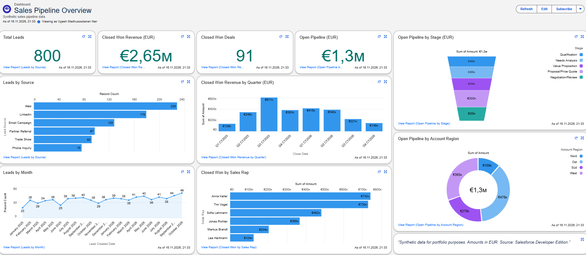
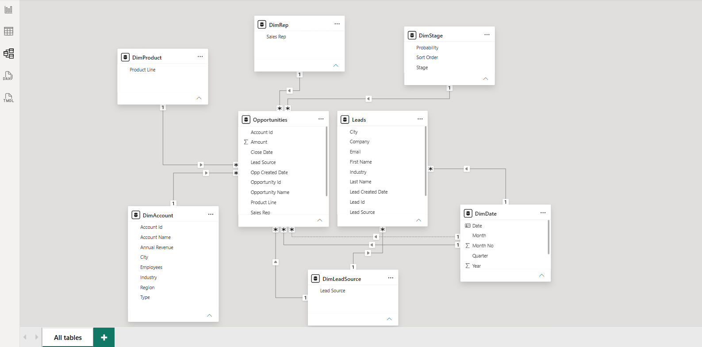
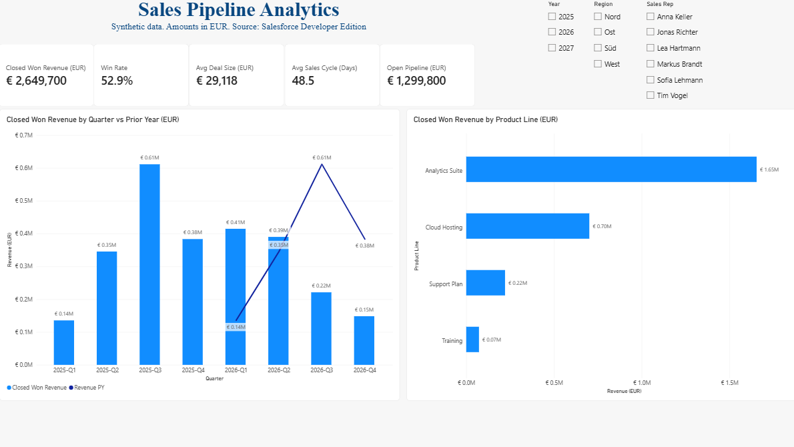
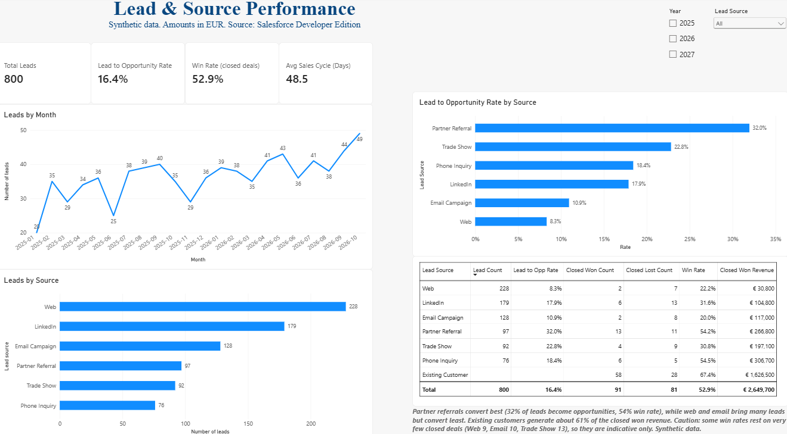
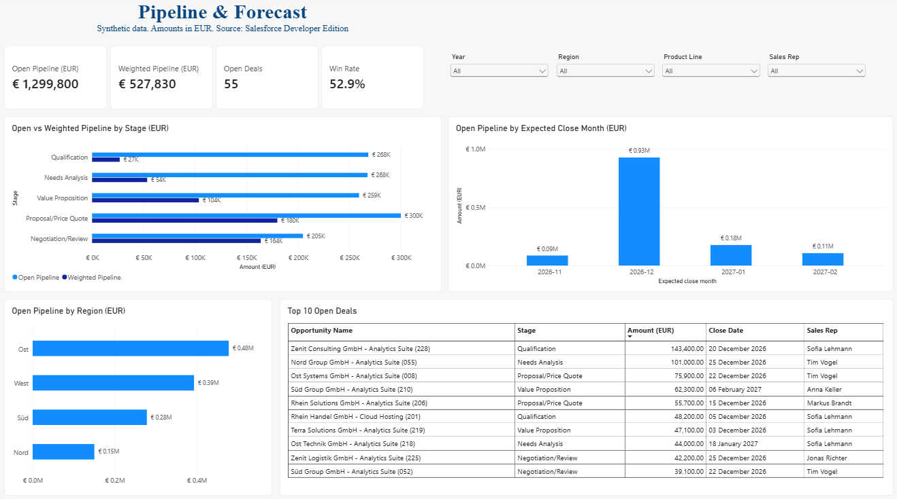
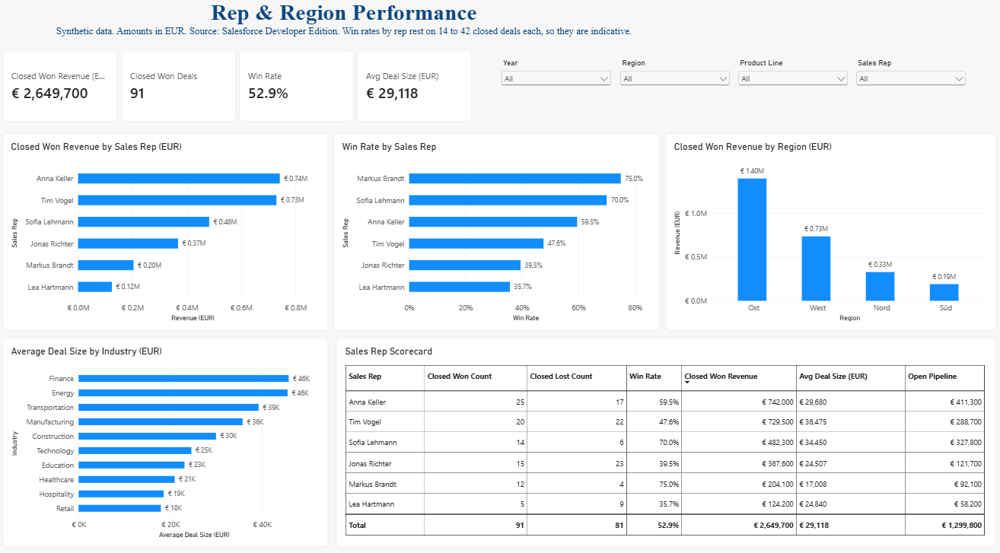
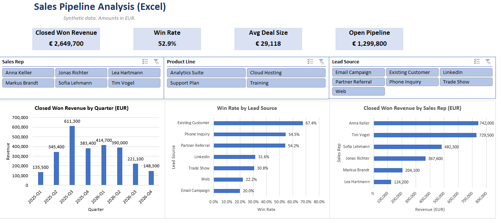
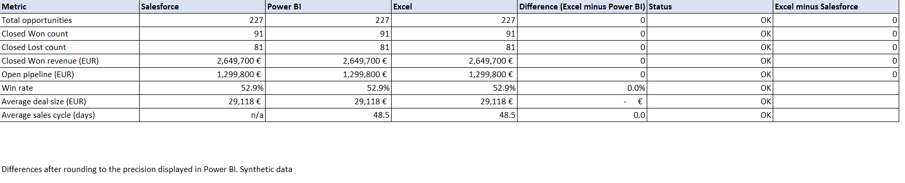

# Sales Pipeline Analytics: Salesforce CRM, Power BI and Excel

An end-to-end sales pipeline analysis. I built a CRM in Salesforce, reported on it there, analysed the same data in Power BI and Excel, and **reconciled the key numbers across all three tools**.

> **Data note:** the data is **synthetic**. It was generated with `data/generate_data.py` (company names and people are invented, emails use example.com). Realistic patterns were built in on purpose (for example partner referrals converting better than web leads), so the findings show my **method**, not real business results.

## Business questions

- Which lead sources produce the most leads, and which convert best?
- How much revenue is won, per quarter, rep, region and product line?
- How healthy is the open pipeline, and how much of it is likely to close (weighted pipeline)?
- Do Salesforce, Power BI and Excel give the same numbers?

## What I built

| Tool | What I did |
|---|---|
| **Salesforce** (Developer Edition) | Created custom fields (Region, Lead Created Date, Sales Rep, Product Line, Opp Created Date) and two formula fields; imported 70 accounts, 140 contacts, 800 leads and 227 opportunities with the Data Import Wizard and dataloader.io; built reports and a dashboard. |
| **Power BI** | Star-schema model with a date table and dimension tables; DAX measures (win rate, weighted pipeline, sales cycle, lead-to-opportunity rate, year-over-year); four report pages. |
| **Excel 2019** | Power Query load, account ID lookup with INDEX/MATCH (Excel 2019 has no XLOOKUP), helper columns, KPI formulas, PivotTables with slicers, a dashboard and a reconciliation sheet. |

## Screenshots

**Salesforce dashboard**



**Power BI: data model (star schema)**



**Power BI: report pages**






**Excel dashboard and reconciliation**




## Reconciliation

Eight metrics were compared in Salesforce, Power BI and Excel. Excel values are rounded to the precision shown in Power BI. All differences are 0.

| Metric | Value |
|---|---|
| Total opportunities | 227 |
| Closed Won / Closed Lost | 91 / 81 |
| Closed Won revenue | 2,649,700 EUR |
| Open pipeline | 1,299,800 EUR |
| Win rate | 52.9% |
| Average deal size | 29,118 EUR |
| Average sales cycle | 48.5 days |

## Example findings (from the synthetic data)

- Partner referrals have the highest lead-to-opportunity rate (about 32%) and web leads the lowest (about 8%).
- Existing customers account for about 61% of closed won revenue.
- The Ost region brings about 53% of closed won revenue.
- Weighted pipeline (527,830 EUR) is far below open pipeline (1,299,800 EUR), and about 71% of the open pipeline is planned to close in December 2026.

## Data quality decisions

- One contact was blocked by Salesforce's duplicate rule (same name and title as another contact). I checked it was a different person and added it manually.
- Q4 2026 is incomplete (the data ends on 5 November 2026), so Q4 comparisons are not meaningful. Year-over-year growth is shown per quarter, and total rows were removed from YoY tables.
- Some win rates rest on few closed deals (for example Web 9, Email Campaign 10), so they are indicative only.

## Repository contents

```
data/           synthetic CSV files and the generator script (generate_data.py)
screenshots/    Salesforce, Power BI and Excel screenshots
powerbi/        Sales_Pipeline_Analytics.pbix
excel/          Sales_Pipeline_Analysis.xlsx
docs/           DAX_measures.md
```

## How to reproduce

1. Run `python data/generate_data.py` to create the CSV files.
2. Import them into a free Salesforce Developer Edition org (accounts, contacts, leads with the Data Import Wizard; opportunities with dataloader.io after matching account IDs).
3. Build the reports and dashboard, then open the Power BI and Excel files (or rebuild them from the same data).

## Skills shown

Salesforce administration and reporting, data import and validation, data modelling (star schema), DAX, Power Query, Excel (INDEX/MATCH, PivotTables, slicers), data quality checks, and clear documentation.

## Author

Vyjesh Madhusoodanan Nair, Berlin. [LinkedIn](https://www.linkedin.com/in/vyjesh-m-nair-57245a24b/)
